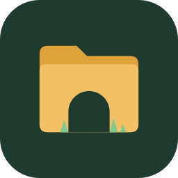

<p align="center">
  
</p>

<h1 align="center">Burrow</h1>

<p align="center">
  A clean, ad-free file manager for Android, with a built-in tool to free up space.
</p>

<p align="center">
  <a href="https://github.com/wellsey001/Burrow/releases/latest"></a>
  <a href="https://github.com/wellsey001/Burrow/actions/workflows/build-apk.yml"></a>
  
  
</p>

---

## Why Burrow?

- **No ads, no tracking, no internet.** Burrow can't connect to the internet at all, so your files never leave your phone.
- **Finds wasted space.** It points out large files, exact duplicates, old downloads, leftover installers and empty folders. Nothing is deleted until you confirm.
- **Plays well with others.** After every change, Burrow tells Android's media library, so gallery and music apps update straight away.

## Install

1. On your phone, open the **[latest release](https://github.com/wellsey001/Burrow/releases/latest)** and tap **Burrow.apk**.
2. If Android asks, allow your browser to *install unknown apps*.
3. Open Burrow, tap **Grant access**, and turn on **Allow access to manage all files**. Android requires this for any app that can see every folder.

Updates install over the top of the old version. To be told about new versions, tap **Watch → Custom → Releases** on this page in the GitHub app.

## Features

| | |
|---|---|
| **Home** | Used and free space for internal storage and SD cards, shortcuts to common folders, categories (Images, Videos, Audio, Documents, Archives, APKs) with sizes, and recent files. |
| **Browse** | List or grid view, with thumbnails for photos, videos, album art and app icons. A tappable path bar jumps to any parent folder. Sort by name, date, size or type, and choose whether to show hidden files. |
| **Organise** | Long-press to select, then copy or move (open another folder and tap **Paste here**), delete, rename, share, open with another app, or see details, including a folder's total size. |
| **Zip** | Compress files into a zip. Tap a zip to extract it into a new folder. |
| **Search** | By name, everywhere or just inside the current folder. Results appear as they're found. |
| **Clean up** | **Large files** over 50 MB; **duplicates** matched by exact contents, where *Select extras* keeps the oldest copy; **old downloads** untouched for 3 months; **APK installers**; **empty folders**. |
| **Progress** | Long copies, moves, zips and extractions show a progress bar with a cancel button. |

## Troubleshooting

- **"App not installed"**: Burrow needs Android 11 or newer. If you installed a build from before 20 November 2026, uninstall it once first, because it was signed with a different key.
- **Blocked by Play Protect**: tap **More details → Install anyway**.
- **Can't see Android/data**: Android blocks every app from reading other apps' private folders. This isn't specific to Burrow.

## Building it yourself

Every push to `main` builds a signed APK with GitHub Actions and publishes it under **Releases**. To build locally, open the folder in Android Studio and press **Run**.

<details>
<summary>Tech and project layout</summary>

Kotlin and Jetpack Compose (Material 3, with your wallpaper colours on Android 12+), with Coil for thumbnails using Android's own thumbnail tools.

```
app/src/main/java/com/wellsey/burrow/
  MainActivity.kt         permission check, tabs, navigation, zip prompt
  data/FileRepository.kt  listing, copy/move/delete, zip/unzip, search, storage scan, duplicates
  data/Thumbnails.kt      photo, video, album art and APK icon thumbnails
  ui/FilesViewModel.kt    app state and actions
  ui/screens/             Home, Browse, Search, Clean up, file lists
```

Signing uses the `SIGNING_KEYSTORE_BASE64` and `SIGNING_PASSWORD` repository secrets. Without them, builds still work but use a temporary key.
</details>

## More apps

- **[Glimpse](https://github.com/wellsey001/Glimpse)**: private photo gallery with editing and a photo map
- **[Folio for Android](https://github.com/wellsey001/Folio-For-Android)**: PDF reader with signing, forms and highlighting
